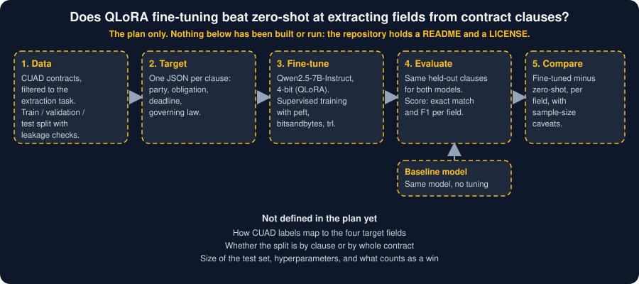

# LLM Finetune Lab

**Question:** does QLoRA fine-tuning of Qwen2.5-7B-Instruct extract the parties, obligations, deadlines and governing law from a contract clause better than the same model used zero-shot?

**Status: plan only.** This repository contains this README and a `LICENSE`. There is no code, no dataset and no result yet.

## Definitions

| Term | Meaning |
| --- | --- |
| **Clause extraction** | Reading one contract clause and returning a JSON object with the fields party, obligation, deadline and governing law. |
| **QLoRA** | Fine-tuning that keeps the base model's weights frozen in 4-bit precision and trains small low-rank adapter matrices on top. |
| **Zero-shot baseline** | The same Qwen2.5-7B-Instruct, given the clause and an instruction, with no fine-tuning. |
| **CUAD** | The Contract Understanding Atticus Dataset: contracts annotated with clause categories ([source](https://www.atticusprojectai.org/cuad)). |
| **Exact match / F1** | Exact match: the extracted value equals the labelled value. F1: overlap between extracted and labelled values, balancing missed and extra items. |
| **Held-out clauses** | Clauses never used in training or validation, used only for the final comparison. |

## Plan

| Step | Choice |
| --- | --- |
| Model | Qwen2.5-7B-Instruct, loaded in 4-bit |
| Data | CUAD, filtered and cleaned to the extraction task, with a documented train / validation / test split and leakage checks |
| Method | Supervised fine-tuning with QLoRA (`peft`, `bitsandbytes`, `trl` `SFTTrainer`) |
| Hardware | One GPU (RunPod) |
| Evaluation | Zero-shot baseline against the fine-tuned model on the same held-out clauses; metric difference with sample-size caveats |

## Status by category

| Category | Done | Pending (planned) | Not planned (gaps) |
| --- | --- | --- | --- |
| **Plan** | Model, task, data source, method, hardware and evaluation design written (this README) | - | - |
| **Data** | - | Download CUAD, filter to the task, split, run leakage checks | How CUAD's clause labels map to the four target fields; whether the split is by clause or by whole contract; dataset size |
| **Training** | - | Training script and a QLoRA run | Hyperparameters, number of epochs, GPU hours and budget |
| **Evaluation** | - | Evaluation harness; zero-shot run; fine-tuned run | Test-set size; per-field metric definitions beyond "exact match and F1"; the margin that counts as an improvement |
| **Results** | - | A metric difference per field | None exist |
| **Comparison with retrieval** | - | - | The README says a comparison with [LexiBridge](https://github.com/arion-a/lexibridge) may follow; no experiment is planned |
| **Repository hygiene** | MIT `LICENSE`; legal-advice disclaimer | - | No code, tests or environment file. The GitHub description says the model is "benchmarked against a zero-shot baseline"; no benchmark has been run. |

## Why this exists

Most public legal-AI tools prompt or retrieve over a frozen model, as [LexiBridge](https://github.com/arion-a/lexibridge) does. This project trains the model on the task instead, so that the two approaches can later be compared or combined.

## Disclaimer

For research purposes. Not legal advice; any downstream use needs a licensed attorney's review.

## License

MIT. See `LICENSE`.
